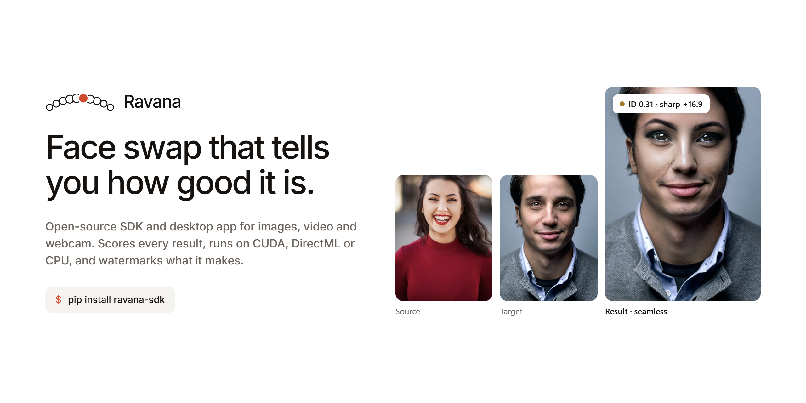
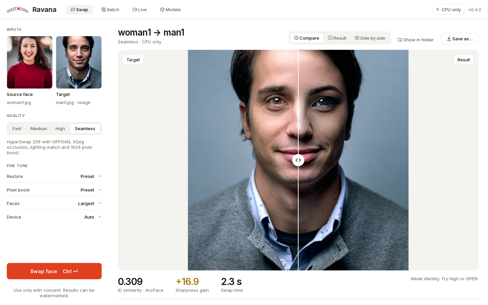
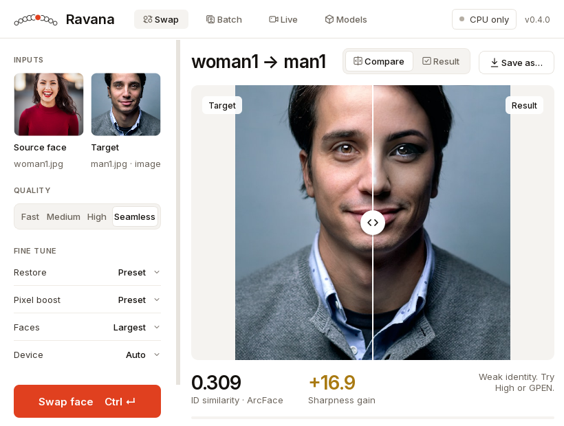
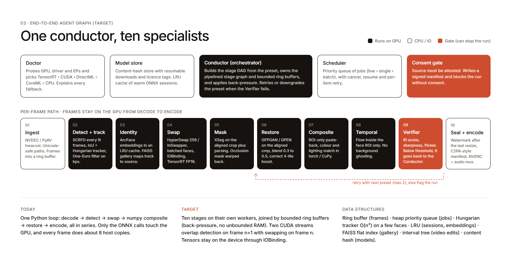
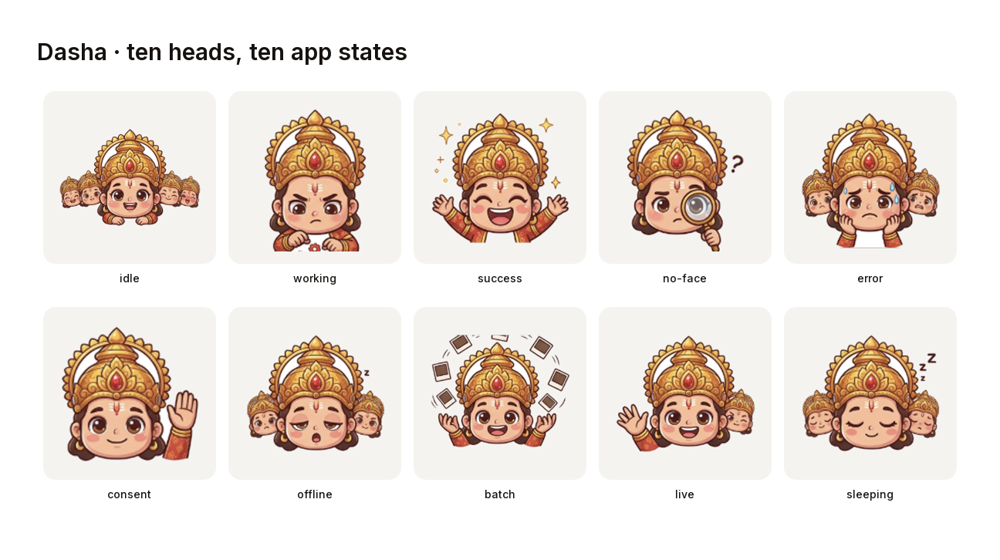

<p align="center">
  
</p>

<p align="center">
  <a href="https://github.com/mrigankad/Ravana/releases"></a>
  
  
  
</p>

**Ravana** is an open-source face-swap SDK and desktop app for images, video and webcam. Most swappers leave you to judge quality by eye. Ravana gives every result an identity score (ArcFace) and a sharpness score, so you can compare settings with numbers instead of guesses.

## Get started

**Windows app.** Download `Ravana-<version>-windows-x64.zip` from [Releases](https://github.com/mrigankad/Ravana/releases), unzip it and run `Ravana.exe`. Models download on first run.

**Python.**

```bash
pip install "git+https://github.com/mrigankad/Ravana.git"     # CPU
pip install "ravana-sdk[gpu] @ git+https://github.com/mrigankad/Ravana.git"       # NVIDIA
pip install "ravana-sdk[directml] @ git+https://github.com/mrigankad/Ravana.git"  # AMD / Intel on Windows
python scripts/first_run_check.py --download   # checks your GPU and fetches models
```

```python
import cv2
from face_swap import FaceSwapConfig, swap_image

out = swap_image(cv2.imread("source.jpg"), cv2.imread("target.jpg"),
                 FaceSwapConfig(quality="seamless", device="auto"))
cv2.imwrite("output.jpg", out)
```

## The desktop app

<p align="center"></p>

Drop a source face and a target, pick a quality, and press **Swap face**. You get:

- a compare slider over the result
- ID and sharpness scores
- one-click variants (GFPGAN, GPEN, boost) to compare side by side

**Batch** and **Live** (webcam) are one tab away.

```bash
pip install -e ".[gui]" && python -m demos.gui
```

The window adapts from 1440 px down to about 780 px wide: the rail narrows, secondary text folds away and the compare canvas keeps the space.

<p align="center"></p>

## What's inside

| | |
|---|---|
| **Swappers** | HyperSwap 256 (seamless), InSwapper 128 (fast) |
| **Restore** | GFPGAN · GPEN · CodeFormer · RestoreFormer++ · OpenCV |
| **Masks** | XSeg occlusion, lighting and colour match |
| **Faces** | `all` · `largest` · `first` · `index` · `pose` |
| **Realtime** | detect-every-N, ROI tracking, light restore for webcam |
| **Scores** | ArcFace identity + sharpness (`evaluate`, `evaluate-batch`, GUI) |
| **Devices** | `device="auto"` picks CUDA, then DirectML, then CPU |

| Preset | Use it for |
|---|---|
| `seamless` | Best stills. HyperSwap, GFPGAN, XSeg, lighting, boost 1024 |
| `high` / `medium` | Video at good speed |
| `fast_cpu` / `low` | No GPU, or quick previews |
| `realtime=True` | Webcam on any preset |

## How it works

<p align="center"></p>

The figure shows the target pipeline. The roadmap below tracks which parts ship today.

## Design kit

The app uses a single 78-icon set (24 px grid, 1.75 stroke) and **Dasha**, a ten-headed mascot with one pose per app state. Source files, usage rules and the build script are in [`design/kit/`](design/kit/KIT.md).

<p align="center"></p>

## CLI

```bash
ravana -s source.jpg -t target.jpg -o out.jpg -q seamless
ravana -s source.jpg -t input.mp4  -o out.mp4 -q medium
python -m demos.webcam_demo -s source.jpg --detect-every 3
ravana models download --preset seamless
ravana evaluate -s source.jpg -t target.jpg -o out.jpg
```

## Roadmap

| Phase | Highlights |
|---|---|
| **P0** | Build the pipeline once per session, correct pixel-boost tiling, ROI compositing, H.264 + audio, cancellable jobs, light theme |
| **P1** | Hardware doctor, IOBinding + TensorRT FP16, stage workers on ring buffers, multi-face tracker, runs history |
| **P2** | Full GPU frame path (NVDEC → NVENC), virtual camera, signed provenance manifest |

The full research, gap analysis and plan are in [`docs/research/`](docs/research/).

## Licences, read before commercial use

The Ravana code is MIT. The **default model weights are not**:

- InsightFace models are for non-commercial research.
- CodeFormer is under the NTU S-Lab licence.
- HyperSwap is under ResearchRAIL.

Check each model's licence before shipping anything.

## Use it responsibly

Ravana is for VFX, entertainment, privacy and creative work **with the consent of everyone shown**. Don't use it to impersonate, deceive or harass. Label synthetic media where the law requires it (for example EU AI Act Art. 50). An optional invisible watermark is available for provenance.

## Contributing

```bash
python -m pytest tests/ -q
```

Changelog: [CHANGELOG.md](CHANGELOG.md) · Docs: `mkdocs serve`
